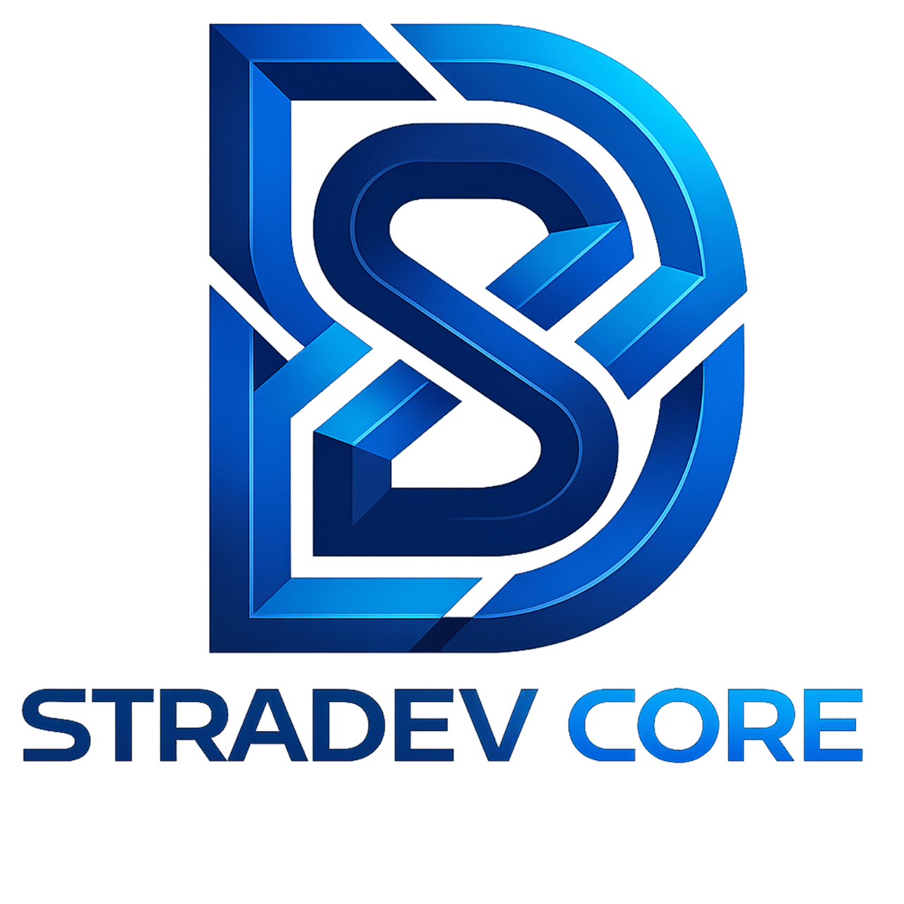

# StraDev Core

### Software built to ship. Code you own.

A small software team in **Jaffna, Sri Lanka**, building web apps, mobile apps, AI features and IoT systems for startups and growing businesses worldwide.

---

## What we build

| | Service | What it means for you |
|---|---|---|
| 🌐 | **Web Applications** | Fast, secure web apps and SaaS products, from first version to scale. |
| 📱 | **Mobile Applications** | iOS and Android apps that feel native and are easy to maintain. |
| 🤖 | **AI Development & Integrations** | Practical AI features added to your product, with a clear view of data, risk and cost. |
| 🔌 | **IoT & Embedded Systems** | From sensor to dashboard: firmware, connectivity and the app on top. |
| ☁️ | **App Hosting & Cloud Services** | Reliable hosting, deployment and monitoring, with no surprise bills. |
| 🔍 | **SEO & Content Improvement** | Technical SEO, fixes and content that help the right people find your site. |

---

## How we work

- **Fixed-scope written quotes.** You know the cost before we start.
- **A working URL in week one.** You see real progress early, not a plan on paper.
- **Weekly progress updates.** What was built, what's next, what's blocked.
- **You own 100% of the code and accounts.** From day one, with a clean handover.
- **A reply within one working day.** Monday to Sunday.

### What we won't do

- Promise you #1 on Google. Nobody controls that.
- Buy backlinks or use shortcuts that put your site at risk.
- Lock you in. Your code, your accounts, your call.

---

## Our stack

We choose tools to fit the product, not the other way round. Our own site runs on:

---

## Working with us

| If you are... | Start here |
|---|---|
| **A startup founder** with an idea or an MVP to build | Book a free 30-minute scoping call. Tell us what you're building and who it's for. |
| **An agency, studio or consultant** who needs extra build capacity | Send us one small, clearly scoped piece. You keep the client; we build to a fixed-scope quote. |
| **A business with a site or app that needs work** | Ask us about an audit, hosting, SEO or a feature build. |

**Typical project sizes:** under $5k · $5–15k · $15–40k · $40k+

To get an accurate quote, send us three lines: *what you're building, who it's for, and a rough budget band.*

---

## Open source

We share starters, tools and templates here when they're ready for other people to use. Watch or follow the organization to see new repositories.

Found a bug or have an idea in one of our repositories? Open an issue. For anything private, email us.

---

## Get in touch

| | |
|---|---|
| 🌐 **Website** | [stradevcore.com](https://stradevcore.com) |
| ✉️ **Email** | [contact@stradevcore.com](mailto:contact@stradevcore.com) |
| 💬 **WhatsApp** | [+94 75 959 6198](https://wa.me/94759596198) |
| 📅 **Free scoping call** | [cal.com/stradevcore/30min](https://cal.com/stradevcore/30min) |
| 📍 **Based in** | Jaffna, Sri Lanka · working worldwide |

© StraDev Core · Jaffna, Sri Lanka

